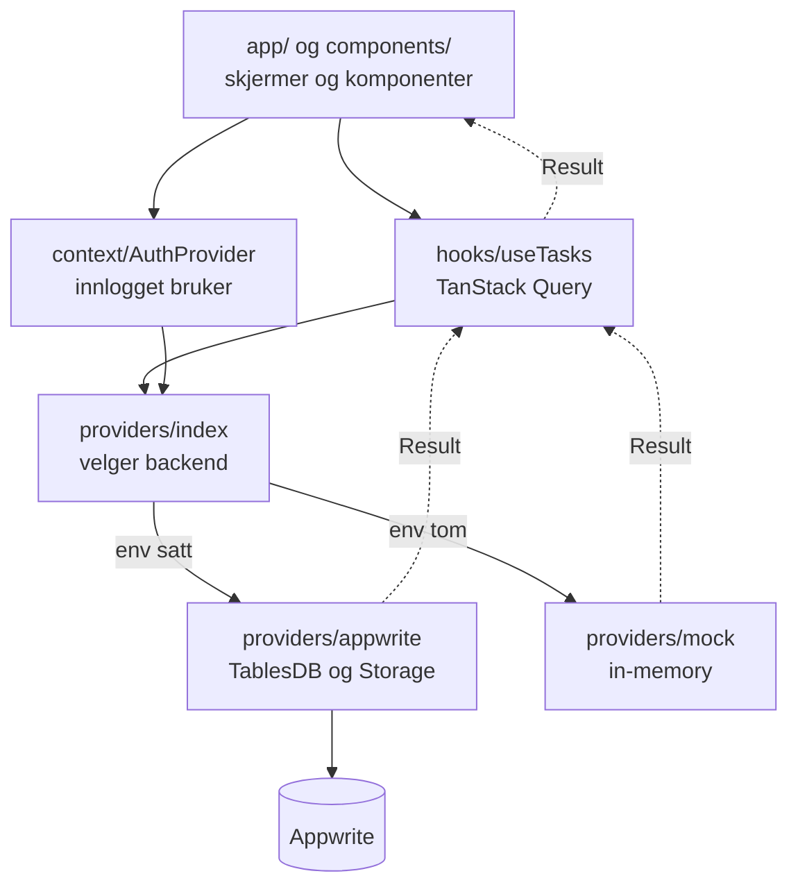
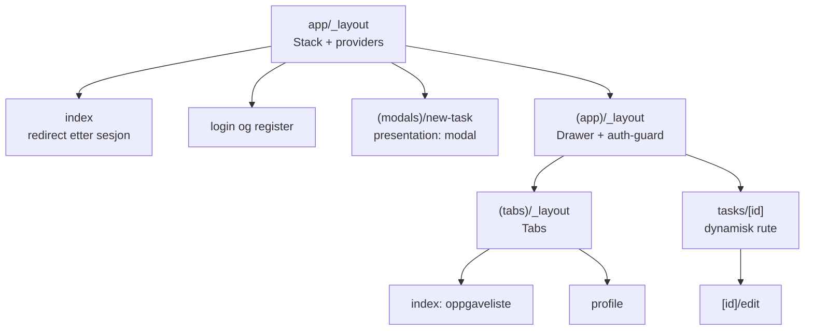
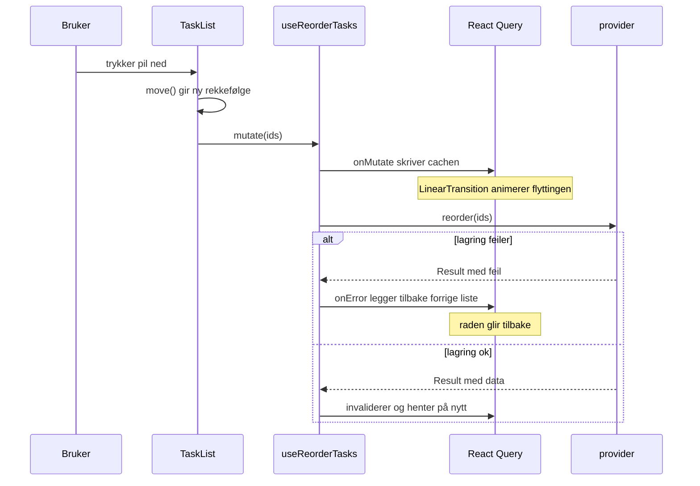

# Tasks-app i React Native

```
Expo SDK 57.0.18 · React Native 0.86.3 · React 19.2.3 · TypeScript 6.0.3
```

Mobil-motstykket til [`hiof-webapp/2026/demo`](../../../hiof-webapp/2026/demo).
Samme oppgavemodell, men uten RSC-kontrasten, som ikke finnes i React Native.

I stedet viser den fire ting web ikke har: bilde tatt med kameraet, en liste
som animeres når rekkefølgen endres, fire navigasjonstyper i samme app, og en
backend som kan byttes ut uten at resten av koden merker det.

Alt bygger på det leksjonene har lært bort, med ett unntak: testkjøreren.
`vitest`, `vitest-expo`, `vitest-native` og `test-renderer` er nye, og
begrunnes under «Om testkjøreren». To mønstre er også nye, og merket som det:
optimistisk oppdatering med tilbakerulling, og det byttbare `Backend`-grensesnittet.

---

## Kjøremiljø

> **Bruk pnpm, ikke npm eller yarn.**
>
> Prosjektet er avhengig av tre pnpm-spesifikke ting, alle i
> `pnpm-workspace.yaml` og `.npmrc`:
>
> 1. En override som pinner `lightningcss`, ellers bygger ikke NativeWind
> 2. En override som pinner `expo-file-system`, ellers linkes to kopier av en
>    native modul
> 3. En patch på `react-native-appwrite`, som peker den mot
>    `expo-file-system/legacy`
>
> npm leser ingen av dem. Leksjon `l-30` har samme krav og sier det samme.
>
> ```bash
> corepack enable pnpm
> ```

**Bruk emulator eller simulator, ikke Expo Go.** Expo Go henger etter
SDK-utgivelsene, og leksjonene krever Expo Go for SDK 56 mens denne appen er på
57. Du kan ikke ha begge installert samtidig.

```bash
pnpm install
pnpm start --ios        # iOS-simulator
pnpm start --android    # Android-emulator
```

Appen starter på **demodata** uten videre oppsett. Vil du ha ekte backend, se
[APPWRITE.md](./APPWRITE.md).

### Kamera krever ekte telefon

Expo merker `expo-camera` som **device only** på både iOS og Android. iOS
Simulator har ikke noe kamera i det hele tatt. En Android-emulator kan
eksponere et virtuelt kamera hvis det er satt opp, så der kan det virke, men
en ekte telefon er det eneste som er garantert.

Resten av appen, inkludert innlogging, lister, reordering og navigasjon,
fungerer fint i emulator. `TaskCamera.tsx` kaller `CameraView.isAvailableAsync()` først, og viser en
melding om at kamera mangler i stedet for et tomt skjermbilde.

---

## Hva appen gjør

| Skjerm | Rute | Viser |
| --- | --- | --- |
| Innlogging | `/login`, `/register` | Auth med context |
| Oppgaveliste | `/(app)/(tabs)` | Liste, filtrering, animert reordering |
| Profil | `/(app)/(tabs)/profile` | Tabs, utlogging |
| Detalj | `/(app)/tasks/[id]` | Dynamisk rute, bilde |
| Rediger | `/(app)/tasks/[id]/edit` | Skjema med validering |
| Ny oppgave | `/(modals)/new-task` | Modal-presentasjon |
| Meny | drawer | Drawer-navigasjon |

---

## Oversikt

### Nivå 1: lagene

Alt over `providers/` vet ingenting om hvilken backend som er i bruk.



Ansvarsfordelingen:

| Lag | Eier | Eier ikke |
| --- | --- | --- |
| `app/` | Ruter og skjermlayout | Datahenting |
| `components/` | Presentasjon og interaksjon | Nettverk |
| `hooks/` | Cache, invalidering, optimistisk oppdatering | HTTP |
| `providers/` | Alt som snakker med omverdenen | UI |
| `types/` | Hva som er gyldig | Alt annet |

### Nivå 2: navigasjonen

Fire navigasjonstyper i ett tre. Parentesene er route-grupper: de påvirker
strukturen, men ikke URL-en.



Drawer importeres fra `expo-router/drawer`. Det som er nytt i nyere versjoner
er at expo-router pakker navigatoren selv og bruker
`react-native-drawer-layout` internt, så `@react-navigation/drawer` ikke trengs. Verken denne appen
eller `l-29` og `l-30` har den installert.

### Nivå 3: hva som skjer når du flytter en rad



---

## Filguide

### Ruter

| Fil | Hva den gjør |
| --- | --- |
| `app/_layout.tsx` | Rot. Providers, `GestureHandlerRootView` og Stack. Start her. |
| `app/index.tsx` | Sender deg til lista eller til innlogging, ut fra sesjonen |
| `app/login.tsx`, `register.tsx` | Skjemaer mot `AuthProvider` |
| `app/(app)/_layout.tsx` | Drawer, og vakten som holder alt under `(app)` bak innlogging |
| `app/(app)/(tabs)/_layout.tsx` | Tabs inne i draweren |
| `app/(app)/(tabs)/index.tsx` | Oppgavelista med flytende plussknapp |
| `app/(app)/(tabs)/profile.tsx` | Profil, statistikk og utlogging |
| `app/(app)/tasks/[id]/index.tsx` | Detaljside. `useLocalSearchParams` leser `[id]` |
| `app/(app)/tasks/[id]/edit.tsx` | Redigering. Gjenbruker `TaskForm` |
| `app/(modals)/new-task.tsx` | Samme skjema som redigering, men som modal |

### Komponenter

| Fil | Hva den gjør |
| --- | --- |
| `TaskList.tsx` | Filtrering og rekkefølge. `move()` regner ut ny rekkefølge |
| `TaskListItem.tsx` | Én rad. `Animated.View` med `layout={LinearTransition}` |
| `TaskForm.tsx` | TanStack Form + Zod. Brukes av både ny og rediger |
| `TaskCamera.tsx` | `CameraView`, `takePictureAsync`, opplasting |
| `shared/QueryWrapper.tsx` | Laster, feiler eller viser data, ett sted |
| `shared/Loading.tsx` | Spinner med ledetekst |
| `shared/ErrorMessage.tsx` | Feilmelding med `accessibilityRole="alert"` og retry |
| `shared/Empty.tsx` | Tom tilstand med forklarende hint |
| `shared/MockBadge.tsx` | Det gule merket når appen kjører på demodata |

### Data

| Fil | Hva den gjør |
| --- | --- |
| `types/index.ts` | Zod-skjemaene. Typene utledes, så de kan ikke sprike |
| `providers/contract.ts` | Grensesnittet begge backender oppfyller |
| `providers/types.ts` | `Result<T>`, den diskriminerte unionen |
| `providers/lib.ts` | `asyncWrapper` og `handleError` |
| `providers/appwrite/client.ts` | Én Appwrite-klient, delt av de tre under |
| `providers/appwrite/auth.ts` | Registrering, innlogging, sesjon |
| `providers/appwrite/tasks.ts` | TablesDB: `listRows`, `createRow`, `updateRow` |
| `providers/appwrite/files.ts` | Storage: opplasting og forhåndsvisning |
| `providers/mock/index.ts` | In-memory, brukt uten `.env` og i testene |
| `hooks/useTasks.tsx` | Query keys, mutasjoner, optimistisk reorder |
| `context/AuthProvider.tsx` | Innlogget bruker. React 19-context |
| `context/QueryProvider.tsx` | `QueryClient` med staleTime og retry |

### Delt kode

| Fil | Hva den gjør |
| --- | --- |
| `constants/keys.ts` | Alle `EXPO_PUBLIC_*` ett sted, og `hasAppwriteConfig` |
| `constants/theme.ts` | Designtokens som speiler `@theme` i `global.css` |
| `utils/cn.ts` | Slår sammen Tailwind-klasser, siste vinner ved konflikt |
| `utils/date.ts` | `formatDate` og `isOverdue`, norsk locale |

---

## Hvor mønstrene kommer fra

Hvert mønster har en leksjon å gå tilbake til.

| I demoen | Leksjon | Sammenlign med |
| --- | --- | --- |
| Filbasert routing, grupper | l-11 til l-14 | `l-30/app/(admin)/` |
| Drawer | l-29 | `l-30/components/layouts/DrawerLayout.tsx` |
| Modal | l-18 | `l-30/app/(modals)/remove-student.tsx` |
| NativeWind v5 | l-19 | `l-30/app/global.css` |
| Context for auth | l-22 til l-24 | `l-30/context/AuthProvider.tsx` |
| TanStack Query | l-26, l-27 | `l-30/hooks/useStudent.tsx` |
| TanStack Form og Zod | l-16, l-17 | `l-30/components/forms/StudentForm.tsx` (skjemanivå-validering og `form.Subscribe`) |
| Appwrite | l-24, l-25, l-28 | `l-30/providers/appwrite/` |
| Kamera | l-20, l-21 | `l-30/components/shared/Camera.tsx` |
| `Result` og `asyncWrapper` | l-24, l-25 | `l-30/providers/appwrite/lib.ts` |
| Mockdata | l-27 | `l-30/constants/students.ts` |
| Testing | l-30 | `l-30/__tests__/` |

---

## React 19, ikke eldre form

Leksjonene er blandet: `l-30/context/AuthProvider.tsx` bruker allerede `use()`,
men fortsatt `<Context.Provider>`, mens `ProfileContext.tsx` bruker
`useContext()`. Denne demoen er konsekvent moderne.

| Gammelt | Her | Finnes det i leksjonene? |
| --- | --- | --- |
| `<Context.Provider value={x}>` | `<Context value={x}>` | Ja, `l-30/context/AuthProvider.tsx` |
| `useContext(Context)` | `use(Context)` | Ja, `l-30/context/ProfileContext.tsx` |
| `React.FC<Props>` | `function Komp({ ... }: Props)` | Én gang, `l-30/components/Search.tsx` |
| `forwardRef` | `ref` som vanlig prop | Nei, ingen leksjon bruker den |

---

## Rekkefølge og animasjon

Hver oppgave har et `order`-felt. Knappene opp og ned bytter plass i lista, og
`layout={LinearTransition}` på `Animated.View` animerer at radene glir på plass.

Det er samme Reanimated-API som `l-30/components/shared/PictureView.tsx`
bruker.

Det imperative worklet-API-et, `useSharedValue` og `useAnimatedStyle`, er
riktignok **undervist** i leksjon 21, men brukes ikke i leksjonskoden.
`Gesture.Pan()`, som dragging faktisk krever, finnes verken i leksjonstekstene
eller i koden. Derfor er dra med fingeren bevisst utelatt. Knapper virker
dessuten med skjermleser, noe dragging ikke gjør.

Lagringen skriver **alle radene** med tette posisjoner 0 til n-1, akkurat som
webapp-demoen. Forskjellen er prisen: der webappen gjør N lokale skriv mot
SQLite, gjør denne N HTTP-kall mot Appwrite. Greit for en liste du ser på én
skjerm, tregt på en lang. Brøkbasert rangering, der den flyttede raden får en
posisjon mellom naboene, er svaret hvis lista vokser.

Nye oppgaver havner bakerst via `MAX(order) + 1`. Ikke `COUNT`, fordi de to
spriker så snart noe er slettet: fjern midten av 0, 1, 2 og antallet er 2 mens
2 fortsatt er opptatt.

---

## Hvor demoen bevisst avviker fra leksjonene

Det meste er kopiert rett fra leksjonsmønstrene. Disse fem er valg, ikke
forglemmelser, og er verdt å vite om før du sammenligner:

| Avvik | Hvorfor | Leksjonens form |
| --- | --- | --- |
| **Optimistisk oppdatering med tilbakerulling** i `useTasks.tsx` | Kjernen i at reordering føles umiddelbar | Leksjon 27 nevner mønsteret i oppsummeringen, men viser det aldri. `l-30/hooks/useStudent.tsx` har bare `cancelQueries` |
| **`Backend`-grensesnitt med byttbar mock** | Lar appen kjøre uten backend | L27 bruker en `testing`-boolean inni selve funksjonen |
| **`ScrollView` + `map()`, ikke `FlatList`** | Layout-animasjoner er enklere utenfor en virtualisert liste | L09 sier `FlatList` når lista kan bli lang. Med mange oppgaver bør dette byttes, se `l-30/components/StudentFlatList.tsx` |
| **`Redirect` i layout, ikke `Stack.Protected`** | Appen har ingen roller å beskytte | L23 viser begge, og leksjonsappen bruker `Stack.Protected` |
| **Tekstglyfer, ikke `@expo/vector-icons`** | Én pakke mindre | Leksjonene bruker `Ionicons` og `SymbolView` fra l-14 |

To ting mangler bevisst, og bør legges til om du utvider demoen:

- **Fristen kan ikke redigeres.** `TaskForm` viser `dueDate` som lesbar tekst.
  Leksjonssvaret er `l-30/components/forms/DateField.tsx` med
  `@react-native-community/datetimepicker`, undervist i L16 og L17.
- **Ingen MSW.** Testene går mot mock-provideren i stedet for å avskjære HTTP,
  som er poenget i L30 og i `l-30/__tests__/integrations/`.

---

## Om tale

Spørsmålet kommer, så her er svaret: vil du **diktere** en oppgave, gjør
mikrofonknappen på systemtastaturet det allerede, i et hvilket som helst
`TextInput`. Ingen pakke trengs. Skjemaet nevner det.

`expo-av` er utfaset. `expo-audio` tar bare opp lyd og kan ikke transkribere.
`expo-speech` går motsatt vei og leser tekst opp. Den eneste som faktisk gjør
tale om til tekst krever development build, og er ikke i leksjonene.

---

## Tester

```bash
pnpm test          # vitest
pnpm test:watch
pnpm lint          # tsc --noEmit
```

Testene kjører mot mock-backenden, så de trenger verken nett eller Appwrite.

| Fil | Dekker |
| --- | --- |
| `__tests__/schema.test.ts` | Zod: dato-coercion, lengdegrenser, ukjente nøkler |
| `__tests__/providers.test.ts` | `Result`, feilmapping, mock-backendens regler |
| `__tests__/useTasks.test.tsx` | Hooks mot mock: lasting, oppretting, reorder |
| `__tests__/TaskListItem.test.tsx` | Rendring, tilgjengelige navn, interaksjon |
| `__tests__/TaskForm.test.tsx` | Validering og hva som når `onSubmit` |

### Om testkjøreren

Vi bruker `vitest-expo`, samme kjører som webapp-demoen, så `describe`, `it`,
`vi.mock` og `vi.fn` er like i begge prosjektene.

**Vær klar over at pakken er ung.** Den har få brukere og én vedlikeholder, og
den underliggende `vitest-native` klarer ikke stripe TypeScript inne i
`node_modules`. Det er derfor `test/setup.ts` stubber `react-native-appwrite`
globalt. Appen er upåvirket; Metro håndterer de samme importene fint.

Skulle den skape trøbbel, er `jest-expo` fallbacken. Byttet er lite:
testkoden er nesten identisk, og bare mock-navnerommet skiller.

| Vitest | Jest |
| --- | --- |
| `vi.mock` | `jest.mock` |
| `vi.fn` | `jest.fn` |
| `vi.spyOn` | `jest.spyOn` |

`l-30` har `jest-expo`-oppsettet kjørende å kopiere fra.

---

## Feilsøking

### `failed to deserialize; expected an object-like struct named Specifier`

Kommer ved bygging, og peker på `app/global.css`. Årsaken er at det ligger to
ulike versjoner av `lightningcss` i treet: `@tailwindcss/postcss` og
`@expo/metro-config` ber om hver sin, og JS-delen og den native binæren må
være enige.

Løsningen ligger i `pnpm-workspace.yaml`:

```yaml
overrides:
  lightningcss: "1.30.1"
```

1.30.1 er versjonen leksjon `l-30` bygger med. Nyere versjoner brekker
`react-native-css`-pipelinen. Endrer du overriden, må du kjøre
`rm -rf node_modules pnpm-lock.yaml && pnpm install` for at den skal slå inn.

Sjekk hva som faktisk er installert:

```bash
ls node_modules/.pnpm | grep lightningcss
```

Det skal være **én** versjon.

### Merkelige feil etter `npm install`

Kjørte du npm i stedet for pnpm, mangler både overridene og patchen. Symptomene
er enten byggefeilen over, eller en app som starter men kræsjer på
filopplasting fordi to kopier av `expo-file-system` er linket.

```bash
rm -rf node_modules package-lock.json
pnpm install
```

Sjekk at det bare er én kopi:

```bash
ls node_modules/.pnpm | grep expo-file-system
```

### Andre vanlige

| Symptom | Årsak |
| --- | --- |
| Klasser i `className` gjør ingenting | Metro må startes med `--clear` etter endring i `global.css` |
| Kameraskjermen sier at kamera mangler | Du kjører i emulator. `expo-camera` krever ekte enhet |
| Tomt gult merke øverst forsvinner ikke | `.env` mangler en av de fire påkrevde nøklene, se `constants/keys.ts` |
| Expo Go klager på SDK-versjon | Denne appen er SDK 57, leksjonene er 56. Bruk emulator |

---

## Backend

Appwrite er standard. Se [APPWRITE.md](./APPWRITE.md) for oppsett fra null.

Redwood-demoen kan brukes i stedet, men er ikke klar som den står. Se
[REDWOOD-BACKEND.md](./REDWOOD-BACKEND.md) for hva som mangler.
