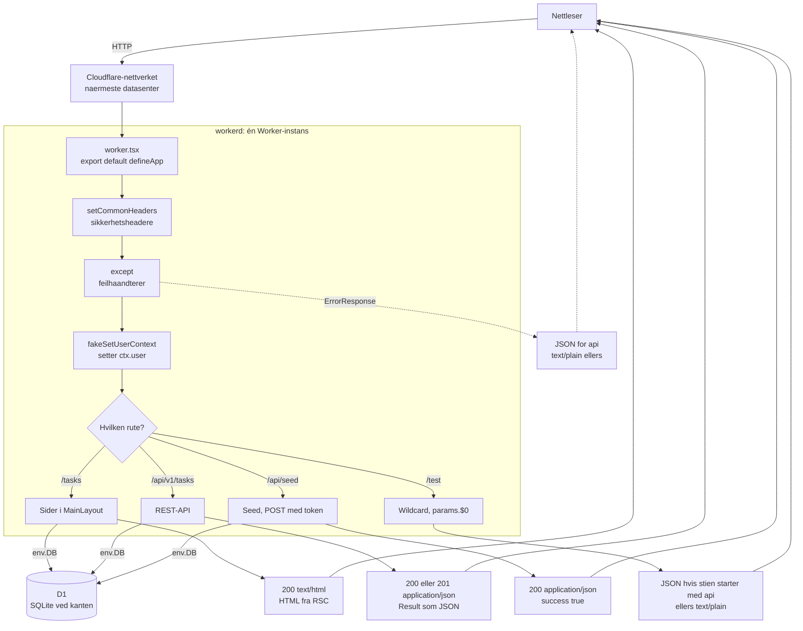
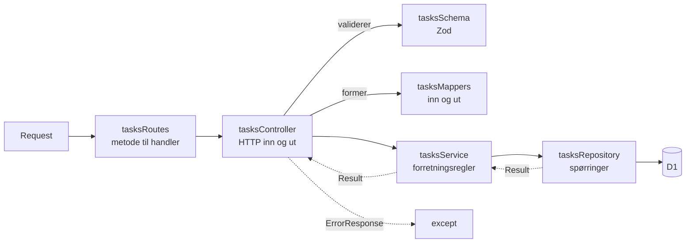
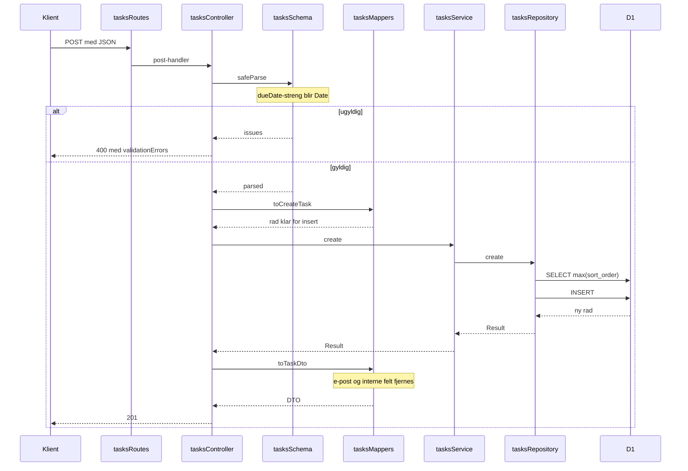
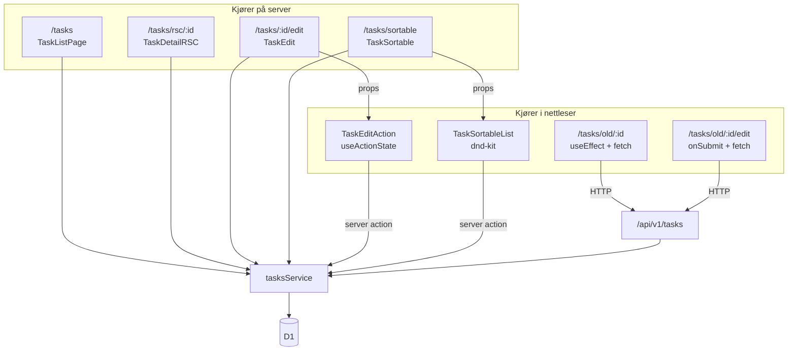
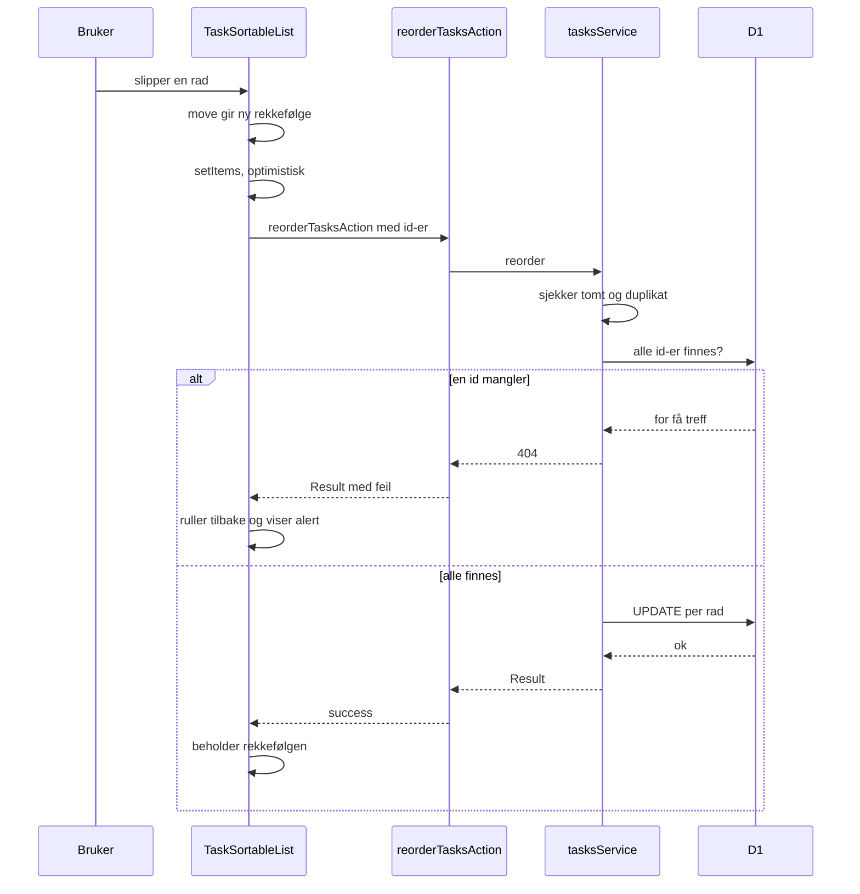
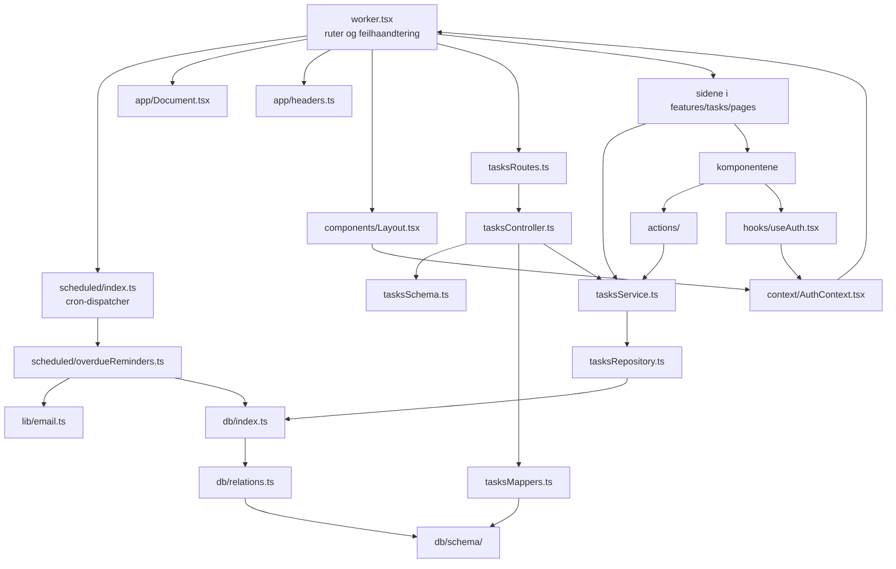
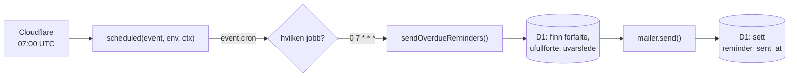

# demo — RedwoodSDK + Drizzle/D1

Demoprosjektet fra forelesningene, oppdatert til 2026-oppsettet (rwsdk 1.7,
Vite 8, React 19, Drizzle v1, Tailwind 4, Zod 4, Vitest og Playwright).

Poenget er sammenligning: de samme oppgavene er løst på flere måter side om
side, så du kan se hva hver teknikk koster og gir.

| Rute | Mønster |
| --- | --- |
| `/` | Enkleste RSC: spør databasen rett i rutehandleren |
| `/tasks` | RSC — server-komponent som henter via service-laget |
| `/tasks/sortable` | Drag and drop med dnd-kit + server action |
| `/tasks/rsc/:taskId` | RSC med ruteparametre |
| `/tasks/old/:taskId` | Klientkomponent som henter via `fetch` mot REST-API-et |
| `/tasks/:taskId/edit` | Server action (`useActionState`) |
| `/tasks/old/:taskId/edit` | Klassisk `onSubmit` + `fetch` |
| `/api/v1/tasks` | REST-API: routes → controller → service → repository, med Zod og mappere |
| `/test/*` | Wildcard-rute (`params.$0`) |

I tillegg har appen et inngangspunkt som ikke er en rute i det hele tatt: en
**cron-jobb** som hver morgen sender e-post om oppgaver som har gått over
fristen uten å bli fullført. Se [Cron](#cron--jobber-som-kjører-på-klokka).

---

## Oversikt

### Nivå 1: hele appen, og hvor Cloudflare kommer inn

#### Hva en Worker er

Hele denne appen er **én Cloudflare Worker**. Det er verdt å bruke et minutt på
hva det innebærer, fordi det forklarer flere valg i koden.

En Worker er en funksjon som kjører på Cloudflares servere, ikke på din. Den
har ingen server du starter og stopper. I stedet leverer du én fil, og
Cloudflare kjører den i **hundrevis av datasentre samtidig**, i det som ligger
nærmest brukeren.

Kjøremiljøet er `workerd`, som bygger på V8 (den samme motoren som i Chrome),
men det er **ikke Node.js**. Det betyr i praksis:

- Du har `fetch`, `Request`, `Response`, `URL` og `crypto` som i en nettleser
- Du har **ikke** `fs`, `path` eller `process` uten videre. `nodejs_compat` i
  `wrangler.jsonc` slår på et utvalg Node-API-er for de bibliotekene som
  trenger dem
- Det finnes ingen langlevende prosess. Hver request kan treffe en fersk
  instans, så du kan ikke lagre tilstand i en global variabel og regne med at
  den er der neste gang

Kontrakten er enkel: filen eksporterer et objekt med en `fetch`-funksjon som
tar en `Request` og returnerer en `Response`. Det er nøyaktig det `defineApp`
lager.

`fetch` er ikke det eneste inngangspunktet. Cloudflare kaller også
**`scheduled`**, på klokka, uten at noen har sendt en request. Derfor ser
bunnen av `src/worker.tsx` slik ut:

```ts
const app = defineApp([ /* ... */ ]);

export default { fetch: app.fetch, scheduled };
```

Se [Cron](#cron--jobber-som-kjører-på-klokka) for hva som ligger bak
`scheduled`.

#### Bindinger: slik når Workeren ut

En Worker kan ikke åpne en databasetilkobling slik en Node-server ville gjort.
I stedet får den **bindinger**: ferdig oppkoblede objekter som Cloudflare
injiserer ved oppstart. Du deklarerer dem i `wrangler.jsonc`, og leser dem med:

```ts
import { env } from "cloudflare:workers";
```

`wrangler types` genererer `worker-configuration.d.ts` fra den samme fila, så
`env.DB` er typet uten at du skriver typene selv. Kjør `pnpm generate` etter
hver endring i `wrangler.jsonc`.

| Binding | Hva det er | Brukes i |
| --- | --- | --- |
| `DB` | **D1**, Cloudflares SQLite ved kanten | `db/index.ts`, `db/seed.ts`, rot-ruten |
| `SEED_TOKEN` | Vanlig variabel fra `vars` | `worker.tsx`, seed-ruten |
| `ASSETS` | Statiske filer fra `public/` | Ikke direkte i kode. rwsdk forventer at bindingen finnes |
| `R2` | Objektlagring for filer | **Ingen steder.** Deklarert og klar til bruk, men demoen laster ikke opp noe |

`wrangler.jsonc` deklarerer også **`triggers.crons`**. Det er ikke en binding
— ingenting injiseres i `env` — men det er den samme ideen: en linje i
konfigurasjonen som avgjør når Cloudflare kaller koden din. Se
[Cron](#cron--jobber-som-kjører-på-klokka).

To ting å være klar over her:

- `R2`-bindingen er med for at den skal være der den dagen du trenger den. Den
  koster ingenting å ha deklarert.
- `public/`-mappa finnes ikke i repoet ennå. `assets.directory` peker dit, så
  opprett den om du legger inn statiske filer.

#### Flyten gjennom appen

`defineApp` bygger en kjede. Alt kjører i rekkefølge til noe returnerer en
`Response`, og `except()` fanger alt som kastes underveis, uansett hvor dypt.

Legg merke til hva som kommer ut i hver gren. Det er den samme Workeren, men
den svarer med tre helt ulike ting.



#### Hva hver gren faktisk returnerer

Tabellen er målt mot en kjørende server, ikke hentet fra hukommelsen.

| Kall | Status | Content-Type | Body |
| --- | --- | --- | --- |
| `GET /` | 200 | `text/html` | HTML strømmet fra RSC |
| `GET /tasks`, `/tasks/rsc/1`, ... | 200 | `text/html` | Samme, men pakket i `Document` og `MainLayout` |
| `GET /api/v1/tasks` | 200 | `application/json` | `{ success, data: TaskDto[], params }` |
| `GET /api/v1/tasks/:id` | 200 | `application/json` | `{ success, data }` der `user` bare har `id` og `name` |
| `POST /api/v1/tasks` | **201** | `application/json` | `{ success, data: TaskDto }` |
| `POST` med ugyldig body | **400** | `application/json` | `{ success: false, error, validationErrors }` |
| `DELETE /api/v1/tasks/:id` | **204** | — | Tom. 204 betyr «gjort, ingenting å si» |
| `DELETE /api/v1/tasks/:id/publish` | **405** | `text/plain` | `Method Not Allowed`, fra rammeverket |
| `POST /api/seed` med token | 200 | `application/json` | `{ success: true }` |
| `POST /api/seed` uten token | **401** | `application/json` | Fra `except()`, siden stien starter med `/api/` |
| `GET /test/api/foo` | 200 | `application/json` | Ruten sjekker selv om første segment er `api` |
| `GET /test/foo` | 200 | `text/plain` | Samme rute, annen gren |
| `GET /finnes-ikke` | 404 | `text/plain` | `Not Found` fra rwsdk, **ikke** fra `except()` |

Tre ting er verdt å feste seg ved:

- **Sider og API er samme Worker.** Forskjellen er bare hva handleren returnerer:
  JSX blir HTML, `Response.json()` blir JSON.
- **`except()` velger format etter sti.** Den sjekker om stien starter med
  `/api/`, og gir JSON i så fall, ellers ren tekst. Det er derfor et 401 på
  seed-ruten er JSON, mens en feil på en side er lesbar tekst.
- **404 på en ukjent rute kommer ikke fra `except()`.** Ingenting kastes når
  ingen rute matcher, så rwsdk svarer sitt eget `Not Found`. `except()` ser
  bare feil som faktisk blir kastet, som `ErrorResponse` fra controlleren.

#### Lokalt mot i skyen

`pnpm dev` kjører `workerd` på maskinen din gjennom Vite, og D1 blir en
SQLite-fil under `.wrangler/`. Det er derfor `pnpm migrate:dev` og
`pnpm migrate:prod` er to kommandoer: den ene treffer fila lokalt, den andre
den ekte databasen.

Koden er den samme begge steder. Det er bindingene som byttes ut.

### Nivå 2: lagene i API-et

Hvert lag har én jobb. Feil bobler opp som `Result` og blir til HTTP helt til
slutt.



Ansvarsfordelingen, som også er grunnen til at det er så mange filer:

| Lag | Eier | Eier ikke |
| --- | --- | --- |
| `tasksRoutes` | Sti og HTTP-metode | Forretningslogikk |
| `tasksController` | Statuskoder, validering, mapping | SQL |
| `tasksSchema` | Formen på data utenfra | Om noe er lov |
| `tasksMappers` | Hva som slippes inn og ut | Validering |
| `tasksService` | Regler: tomt, duplikat, «haxxor» | HTTP og SQL |
| `tasksRepository` | Spørringer og databasefeil | Regler |

### Nivå 3: én request fra ende til ende

`POST /api/v1/tasks` viser hele kjeden, inkludert de to stedene data formes.



### Nivå 4: hvordan sidene henter data

Sidene finnes for å kunne sammenlignes. Forskjellen er hvor dataene hentes og
hvem som eier tilstanden.



Kort sagt:

- **RSC** henter direkte på serveren. Ingen `fetch`, ingen loading-tilstand,
  ingen data sendt til klienten som ikke skal rendres.
- **Server actions** kalles som vanlige funksjoner, men kjører på serveren.
  Skjema går via `useActionState`, drag and drop tar vanlige argumenter.
- **«Old»-sidene** gjør det klassisk over REST. De er med for kontrastens
  skyld, ikke fordi de er anbefalt i dag.

### Nivå 5: dataflyten ved drag and drop

Den eneste flyten der klienten oppdaterer seg før serveren har svart.



---

## Filguide

Hva hver fil gjør og hva den henger sammen med. Bruk den som kart før du åpner
en enkeltfil.

### Avhengigheter mellom filene

Pilene peker samme vei som `import`. Legg merke til at pilene aldri går motsatt
vei: sider kjenner servicen, servicen kjenner repositoryet, og repositoryet
kjenner databasen. Ingen av dem vet noe om laget over seg.



### Inngangspunkt

| Fil | Hva den gjør |
| --- | --- |
| `worker.tsx` | Selve appen. Setter opp middleware-kjeden, `except()`, alle rutene, og typen `AppContext` som gir `ctx.user` i resten av koden. Eksporterer `{ fetch, scheduled }`. Start her. |
| `scheduled/index.ts` | Cron-dispatcheren. Alle cron-uttrykkene treffer samme `scheduled`, så den skiller dem på `event.cron`. |
| `scheduled/overdueReminders.ts` | Selve jobben: finn oppgaver over fristen som ikke er fullført, send e-post, stemple raden. |
| `client.tsx` | Fire linjer som starter React i nettleseren. Trengs for at klientkomponenter skal bli interaktive. |
| `app/Document.tsx` | HTML-skallet rundt alle sider: `<html>`, `<head>`, script-taggen som laster `client.tsx`. |
| `app/headers.ts` | Sikkerhetsheadere på alle svar, inkludert CSP. |
| `components/Layout.tsx` | Layout rundt `/tasks`-sidene. Leser `ctx.user` og legger den i `AuthProvider`. |
| `app/pages/Home.tsx` | Rest fra starteren. **Ikke rutet fra `worker.tsx`**, så den rendres aldri. Beholdt som minste mulige eksempel på en komponent som leser `ctx`. |

### Sidene, og hvorfor det er flere av dem

Dette er kjernen i demoen. Samme oppgave, ulik teknikk.

| Fil | Rute | Teknikk | Sammenlign med |
| --- | --- | --- | --- |
| `pages/TaskListPage.tsx` | `/tasks` | RSC. Kaller servicen direkte på serveren, ingen `fetch`, ingen loading-tilstand. | `TaskSortable` |
| `pages/TaskDetailRSC.tsx` | `/tasks/rsc/:id` | RSC med ruteparameter. Ni linjer totalt, fordi all datahenting skjer på serveren. | **`TaskDetailOld`** |
| `pages/TaskDetailOld.tsx` | `/tasks/old/:id` | Det gamle mønsteret: klientkomponent med `useEffect` og `fetch` mot REST-API-et. Trenger `useState` for data og tåler at den rendres før svaret kommer. Nesten fem ganger så lang som RSC-varianten, for samme resultat. | **`TaskDetailRSC`** |
| `pages/TaskEdit.tsx` | `/tasks/:id/edit` | RSC som henter tasken og sender den som prop til en klientkomponent. Selve skjemaet ligger i `TaskEditAction`. | `TaskEditOld` |
| `pages/TaskEditOld.tsx` | `/tasks/old/:id/edit` | Det gamle mønsteret for skriving: henter med `useEffect`, sender med `onSubmit` og `fetch`. **Kontrollert** input (`value` og `onChange`), så hvert tastetrykk går gjennom React-state. Alt ligger i én fil fordi alt skjer i nettleseren. | **`TaskEditAction`** |
| `pages/TaskSortable.tsx` | `/tasks/sortable` | RSC som henter sortert liste og sender den videre. Selve draingen ligger i `TaskSortableList`. | `TaskListPage` |

Den korteste veien til å forstå RSC er å lese `TaskDetailRSC.tsx` (9 linjer)
og `TaskDetailOld.tsx` (42 linjer) etter hverandre. De gjør det samme.

### Klientkomponentene

Alle har `"use client"` øverst. Det er det som gjør at de kan bruke hooks.

| Fil | Hva den gjør |
| --- | --- |
| `components/TaskEditAction.tsx` | Skjema koblet til en server action med `useActionState`. **Ukontrollert** input (`defaultValue`), så React leser verdien først ved submit. Viser skjelett mens `isPending` er true. |
| `components/TaskSortableList.tsx` | Drag and drop med dnd-kit. Holder rekkefølgen i `useState`, oppdaterer optimistisk, og ruller tilbake hvis lagringen feiler. |

### Server actions

`"use server"` gjør at funksjonen kjører på serveren selv om den kalles fra
nettleseren. De to viser hver sin form.

| Fil | Kalles fra | Signatur |
| --- | --- | --- |
| `actions/editTaskAction.tsx` | `useActionState` i et skjema | `(prevState, formData)`. React bestemmer formen. |
| `actions/reorderTasksAction.tsx` | Drag-handleren direkte | `(ids: string[])`. Vanlige argumenter, fordi det ikke er et skjema. |

### API-laget

| Fil | Ansvar |
| --- | --- |
| `tasksRoutes.ts` | Kobler sti og HTTP-metode til en handler. Metode-objekter, så rammeverket svarer 405 selv. |
| `tasksController.ts` | HTTP inn og ut: leser request, validerer, kaller servicen, mapper svaret, kaster `ErrorResponse` ved feil. Ingen SQL. |
| `tasksSchema.ts` | Zod-skjemaene. Bestemmer formen på det som kommer utenfra. |
| `tasksMappers.ts` | Former data begge veier. Ut-mapperen er den som fjerner e-post. |
| `tasksService.ts` | Forretningsregler: tom oppdatering, duplikate id-er, søkeordet «haxxor». Vet ikke om HTTP. |
| `tasksRepository.ts` | Spørringene. Eneste fil som snakker med Drizzle. Returnerer `Result` i stedet for å kaste. |

Servicen og repositoryet lages med fabrikkfunksjoner
(`createTaskService(repo)`), så du kan sende inn en stub i en test.

### Database

| Fil | Hva den gjør |
| --- | --- |
| `db/schema/task-schema.ts` | Tabellen `tasks` og typene som utledes fra den. Kolonnen `sort_order` heter `order` i TypeScript. |
| `db/schema/user-schema.ts` | Tabellen `users`. |
| `db/schema/index.ts` | Samler begge, og er det `drizzle.config.ts` peker på. |
| `db/relations.ts` | Relations v2: alle relasjoner i ett `defineRelations`-kall. Det er dette som får `db.query.*` til å virke. |
| `db/index.ts` | Selve klienten. Eksporterer også typen `DB`, som er driver-agnostisk så testene kan bruke SQLite i minnet. |
| `db/seed.ts` | Testdata. Kjøres av `pnpm seed` og av `POST /api/seed`. |

### Delt kode

| Fil | Hva den gjør |
| --- | --- |
| `types/result.ts` | `Result` og `ServerResult`. Diskriminert union på `success`, så TypeScript snevrer inn til `data` eller `error`. |
| `lib/id.ts` | `createId()`, en nanoid-wrapper. |
| `lib/email.ts` | `mailer.send()`. Logger bare i demoen, men har formen en ekte leverandør ville hatt. |
| `app/lib/cn.ts` | Slår sammen Tailwind-klasser der den siste vinner ved konflikt. |
| `context/AuthContext.tsx` | React context for brukeren. |
| `hooks/useAuth.tsx` | Leser konteksten, og kaster tydelig hvis provideren mangler. |

---

## Kom i gang

Krever Node 22.12+ og pnpm 10.16+ (`corepack enable pnpm`).

```bash
pnpm install
pnpm migrate:dev   # kjør migrasjonene mot lokal D1
pnpm seed          # legg inn testdata
pnpm dev
```

Åpne `http://localhost:5173`.

---

## Scripts

| Kommando | Hva den gjør |
| --- | --- |
| `pnpm dev` | Utviklingsserver på port 5173 |
| `pnpm build` / `pnpm release` | Bygg / bygg og deploy til Cloudflare |
| `pnpm migrate:new` | Generér ny migrasjon fra `src/db/schema/` |
| `pnpm migrate:dev` / `pnpm migrate:prod` | Kjør migrasjonene lokalt / i prod |
| `pnpm seed` | Legg inn testdata |
| `pnpm test` / `pnpm test:watch` / `pnpm test:coverage` | Vitest |
| `pnpm test tasks.scheduled` | Bare cron-testene (filtrerer på filnavn) |
| `pnpm test:e2e` | Playwright (starter dev-serveren selv) |
| `pnpm test:e2e:ui` | Playwright i grafisk modus med tidslinje |
| `pnpm test:e2e:headed` | Playwright med synlig nettleser |
| `pnpm test:e2e:debug` | Playwright Inspector, steg for steg |
| `pnpm lint` | `tsc --noEmit` |
| `pnpm generate` | Regenerér `worker-configuration.d.ts` fra `wrangler.jsonc` |
| `pnpm preview` | Kjør det bygde resultatet lokalt |
| `pnpm worker:run <fil>` | Kjør et script inne i worker-runtimen |
| `pnpm dev:init` | Engangsoppsett fra rwsdk |
| `pnpm clean` | Slett Vite-cachen i `node_modules/.vite` |

---

## Database

Drizzle v1. To ting er verdt å merke seg hvis du har brukt Drizzle før:

- **Relasjoner defineres samlet** i `src/db/relations.ts` med `defineRelations`,
  ikke per tabell med `relations()`. `fields`/`references` heter nå `from`/`to`.
- **`db.query.*` tar et filterobjekt**, ikke `eq()`:

  ```ts
  await db.query.tasks.findFirst({ where: { id }, with: { user: true } });
  ```

Hver migrasjon får sin egen mappe (`drizzle/migrations/<timestamp>_<navn>/`).
Derfor har `wrangler.jsonc` en `migrations_pattern` — uten den finner wrangler
ingen migrasjoner.

To kolonner på `tasks` er verdt en kommentar fordi navnet i TypeScript og i SQL
ikke er det samme, eller fordi de finnes for noe annet enn skjermbildet:

| TypeScript | SQL | Hvorfor |
| --- | --- | --- |
| `order` | `sort_order` | `order` er reservert ord i SQL |
| `reminderSentAt` | `reminder_sent_at` | Gjør cron-jobben idempotent. NULL til e-posten er sendt. Se [Cron](#cron--jobber-som-kjører-på-klokka) |

### Rekkefølge og drag and drop

`/tasks/sortable` lar deg dra radene i ny rekkefølge. Posisjonen lagres i
feltet `order` på task.

Kolonnen i databasen heter **`sort_order`**, ikke `order`, fordi `order` er et
reservert ord i SQL. Drizzle quoter alle identifikatorer, så `order` ville
fungert, men rå SQL i migrasjoner og håndskrevne spørringer blir en felle.
TS-feltet heter `order`.

Tre ting er verdt å merke seg i koden:

- `reorderTasksAction` tar **vanlige argumenter, ikke FormData**. Den kalles
  rett fra drag-handleren, ikke fra et skjema. Sammenlign med `editTaskAction`,
  som er en skjema-action brukt via `useActionState`.
- Lista oppdateres **optimistisk** i klienten, og rulles tilbake hvis lagringen
  feiler.
- Bare denne siden sorterer på `order`. `GET /api/v1/tasks` og `/tasks`
  sorterer fortsatt på `dueDate`, gjennom `findMany`. Den sorterte spørringen
  ligger i `findManyOrdered`.

Tastaturet fungerer også, siden dnd-kit har en `KeyboardSensor` på som
standard: tab til håndtaket, `Space` for å løfte, piltaster for å flytte,
`Space` for å slippe, `Escape` for å avbryte.

**Nye tasks legges bakerst.** `create` setter `order` til `MAX(sort_order) + 1`.
Grunnen til at det ikke er `COUNT(*)` er at de to spriker så snart noe er
slettet: fjerner du midten av 0, 1, 2 er antallet 2, men 2 er fortsatt opptatt,
så `COUNT` ville delt ut en duplikat posisjon. Sender du inn `order` eksplisitt
vinner den, og det er det seed-scriptet bruker.

For de nysgjerrige på ytelse: `create` koster én ekstra `SELECT` per innsetting,
og `reorder` skriver om alle radene ved hvert slipp, altså N skrivinger per
flytting. Begge deler er uproblematisk for en liste du ser på én skjerm. Store
lister bruker i stedet brøkbasert rangering, der elementet får en posisjon
mellom naboene sine så bare én rad røres, mot at man må normalisere når
brøkene går tom for presisjon.

### Seeding

`pnpm seed` er den vanlige veien. `POST /api/seed` gjør det samme over HTTP,
men krever headeren `x-seed-token`. Tokenet ligger som `SEED_TOKEN` i
`vars` i `wrangler.jsonc` og er `12345` til å begynne med.

Ruten tømmer og fyller databasen, så den er POST-only med vilje: en
destruktiv GET kan trigges av en crawler eller en lenke-prefetch. `vars` er
offentlige, så bytt tokenet og gjør det til en ekte secret
(`wrangler secret put SEED_TOKEN`) før du deployer noe sted.

---

## Validering og mapping

To filer står mellom HTTP og databasen, og de har hver sin jobb.

### `tasksSchema.ts` — hva som slipper inn

Zod 4. Alt som kommer utenfra parses med `safeParse`, som returnerer et
resultat i stedet for å kaste. Det passer `Result`-mønsteret resten av lagene
bruker.

Den viktigste linja er denne:

```ts
dueDate: z.coerce.date().optional(),
```

JSON har ingen datotype, så `dueDate` kommer inn som en streng. Drizzles
timestamp-kolonne kaller `.getTime()` på det den får, og en uparset streng
feiler derfor helt nede i driveren med `value.getTime is not a function`.
`z.coerce.date()` gjør om strengen i ytterkanten, som er der konverteringen
hører hjemme.

Navnereglene (`min(3).max(200)`) speiler `minLength` og `maxLength` på skjemaet
i `TaskEditAction.tsx`, så nettleseren og serveren er enige om hva som er
gyldig.

Ugyldig input gir 400 med feil per felt:

```json
{
  "success": false,
  "error": { "message": "Validation failed", "code": 400 },
  "validationErrors": {
    "name": ["Too small: expected string to have >=3 characters"],
    "userId": ["Too small: expected number to be >0"]
  }
}
```

### `tasksMappers.ts` — hva som slipper ut

Mapperne går begge veier:

- **Inn:** `toCreateTask` og `toUpdateTask` former validert input til en rad.
  `toUpdateTask` kopierer bare nøkler som faktisk finnes, så en PATCH aldri
  overskriver en kolonne med `undefined`. Merk at `false` må overleve, siden
  den er falsy men til stede.
- **Ut:** `toTaskDto` og `toTaskWithUserDto` bestemmer hva klienten får se.

Ut-mapperen er den som faktisk fjerner data. `findById` bruker
`with: { user: true }`, som selekterer **alle** kolonner på brukeren, e-post
inkludert. Typen `TaskWithUser` sier at brukeren bare er `{ id, name }` — men
en type er borte ved runtime og kan ikke fjerne noe. Uten mapperen sender du
e-posten til alle som spør:

```ts
// Uten mapper
{ "user": { "id": 7, "name": "Kari", "email": "kari@test.local" } }

// Med toTaskWithUserDto
{ "user": { "id": 7, "name": "Kari" } }
```

Mapperen serialiserer også `dueDate` eksplisitt til ISO-streng i stedet for å
overlate det til `JSON.stringify`, så wire-formatet bestemmes ett sted.

---

## Cron — jobber som kjører på klokka

Alt annet i denne appen starter med at noen ber om noe. En cron-jobb gjør ikke
det. Cloudflare kaller Workeren på et tidspunkt du har bestemt, uten request,
uten bruker og uten nettleser.

Demoen bruker det til én ting: **sende e-post om oppgaver som har gått over
fristen uten å bli fullført**. Det er et typisk eksempel, fordi ingen besøker
en side for å bli minnet på noe de har glemt.

### Delene

| Fil | Ansvar |
| --- | --- |
| `wrangler.jsonc` → `triggers.crons` | Når jobben kjører |
| `src/worker.tsx` | Eksporterer `scheduled` ved siden av `fetch` |
| `src/scheduled/index.ts` | Dispatcher: hvilket cron-uttrykk var det? |
| `src/scheduled/overdueReminders.ts` | Selve arbeidet |
| `src/lib/email.ts` | `mailer.send()` — logger i demoen, ekte leverandør i praksis |



Registreringen er tre linjer i `wrangler.jsonc`:

```jsonc
"triggers": {
  "crons": ["0 7 * * *"]
}
```

og ett ekstra felt på default-eksporten i `src/worker.tsx`:

```ts
export default { fetch: app.fetch, scheduled };
```

### Fire ting som er lette å gå på

**Alle cron-uttrykk treffer samme handler.** Legger du til et uttrykk til, blir
det ikke en ny funksjon — det blir det samme `scheduled`-kallet med en annen
`event.cron`. Derfor `switch`-en i `src/scheduled/index.ts`, og derfor må
strengene der matche `wrangler.jsonc` tegn for tegn. Ett ekstra mellomrom, og
jobben kjører aldri. Du får en `console.warn`, ikke en feil.

**Cron er alltid UTC.** `0 7 * * *` er 09:00 norsk tid om sommeren og 08:00 om
vinteren. Det finnes ingen tidssone-innstilling.

**Bruk `ctx.waitUntil`.** Handleren returnerer med én gang, og uten `waitUntil`
kan runtimen rive ned kjøringen midt i utsendingen.

**Jobben må være idempotent.** Cloudflare garanterer *minst* én kjøring, ikke
nøyaktig én, og du kommer selv til å trigge den for hånd mens du tester. Kjører
jobben to ganger, skal ikke folk få to e-poster.

Det siste er grunnen til kolonnen `reminder_sent_at` på `tasks`:

```ts
where(
  and(
    lt(tasks.dueDate, now),                                       // over fristen
    or(isNull(tasks.completed), eq(tasks.completed, false)),      // ikke fullfort
    isNull(tasks.reminderSentAt),                                 // ikke varslet
  ),
)
```

Raden stemples først **etter** at e-posten faktisk gikk ut. Feiler sendingen,
står `reminder_sent_at` fortsatt tom, og neste kjøring prøver på nytt. Det er
derfor `mailer.send` returnerer `false` i stedet for å kaste: én ugyldig adresse
skal ikke stoppe resten av bunken.

Legg merke til `isNull(tasks.completed)` også. `completed` har `default(false)`,
men ikke `notNull()`, så kolonnen er nullbar — og i SQL er `completed = 0`
*usant* for NULL, ikke sant. Uten den ene ekstra sjekken ville rader med NULL
aldri blitt varslet om, helt stille.

`reminder_sent_at` lekker forresten ikke ut av API-et. `toTaskDto` i
`tasksMappers.ts` lister opp feltene den sender, så en ny kolonne blir ikke
automatisk med i svaret. Det er hele poenget med en ut-mapper.

---

### Slik tester du det

Tre nivåer, fra raskest til mest ekte.

#### 1. Vitest — den du kjører hele tiden

Dette er hovedmåten, og den er mulig fordi `scheduled` ikke gjør noe selv: den
kaller `sendOverdueReminders()`, som er en helt vanlig funksjon. Da trenger du
verken Worker-runtime, cron-trigger eller e-postleverandør for å teste
oppførselen.

```bash
pnpm test
pnpm test tasks.scheduled          # bare cron-testene
```

Testene ligger i [`src/test/__tests__/tasks.scheduled.test.ts`](src/test/__tests__/tasks.scheduled.test.ts)
og bruker nøyaktig de samme tre mockene som resten av integrasjonstestene:

```ts
vi.mock("@/db", () => import("@/test/db-mock"));
vi.mock("rwsdk/worker", () => import("@/test/worker-mock"));
vi.mock("cloudflare:workers", () => import("@/test/env-mock"));
```

To ting er injisert i signaturen nettopp for at dette skal gå:

```ts
sendOverdueReminders(now: Date = new Date(), db: DB = productionDb)
```

- **`now`** — testen bestemmer hva «over fristen» betyr, i stedet for å tukle
  med systemklokka. Frister settes relativt til en fast `NOW`.
- **`db`** — testen sender inn SQLite-klienten fra `db-mock`, som har kjørt de
  samme migrasjonene som D1. Spørringen som testes er den ekte.

E-posten fanges med et spy, ikke en mock av hele modulen:

```ts
const send = vi.spyOn(mailer, "send").mockResolvedValue(true);
```

Det er grunnen til at `src/lib/email.ts` eksporterer et **objekt** med en
metode og ikke en løs funksjon: `vi.spyOn` kan ikke overskrive en
ES-modul-eksport, men den kan bytte ut en metode på et objekt.

Det testene faktisk dekker:

Testnavnene er på engelsk, som i resten av suiten:

| Test | Hva den sikrer |
| --- | --- |
| `mails the owner about a task that is past its due date` | Lykkelig sti, med riktig mottaker og emne |
| `leaves tasks that still have time alone` | `dueDate`-filteret |
| `leaves completed tasks alone` | `completed`-filteret |
| `includes tasks where completed is NULL` | Trerverdi-logikken over |
| **`is idempotent — the second run sends nothing`** | Andre kjøring sender ingenting |
| `stamps reminder_sent_at on the rows that were actually sent` | Sideeffekten i databasen, ikke bare returverdien |
| `leaves reminder_sent_at empty when sending fails, so it is retried` | At en feilet e-post prøves igjen |
| `sends one mail per task, to the right owner` | Join-en mot `users` |
| `does nothing against an empty database` | Ingen krasj når det ikke er noe å gjøre |

#### 2. Trigg jobben for hånd, i ekte runtime

Vitest kjører i Node. Vil du se at `scheduled`-eksporten faktisk er koblet opp,
og at spørringen går mot ekte D1, kan du kalle `scheduled`-handleren over HTTP
mens `pnpm dev` kjører:

```bash
pnpm migrate:dev
pnpm seed
pnpm dev
```

I et annet terminalvindu:

```bash
curl "http://localhost:5173/cdn-cgi/handler/scheduled?cron=0+7+*+*+*"
```

`cron`-parameteret er det `event.cron` blir, så det er dette som avgjør hvilken
gren i `switch`-en som kjører. Mellomrommene må kodes som `+` eller `%20`.

I terminalen der `pnpm dev` kjører, ser du:

```
[email] -> test@testuser.io: Oppgaven "Task 3" har gått over fristen
[reminders] fant 1, sendte 1, feilet 0
```

Seed-dataene inneholder «Task 3» med frist to dager tilbake i tid, nettopp så
det finnes noe å finne.

Kjør den **en gang til**, og du ser idempotensen med egne øyne:

```
[reminders] fant 0, sendte 0, feilet 0
```

Vil du kjøre den om igjen for ekte, nullstill databasen med `pnpm seed`.

Send et uttrykk som ikke er registrert, og du får `default`-grenen:

```bash
curl "http://localhost:5173/cdn-cgi/handler/scheduled?cron=*+*+*+*+*"
# [scheduled] Ukjent cron-uttrykk: * * * * *
```

Det er akkurat den feilen du får hvis strengene i `wrangler.jsonc` og
`src/scheduled/index.ts` sklir fra hverandre — verdt å se en gang, så du
kjenner den igjen.

> Endepunktet finnes bare lokalt. `/cdn-cgi/`-stier er reservert av Cloudflare
> og er ikke tilgjengelige på en deployet worker, så dette er ingen bakdør i
> produksjon.

#### 3. I skyen

Cron-triggere kjører aldri lokalt av seg selv — bare i en deployet worker.

```bash
pnpm release             # bygger og deployer, inkludert triggerne
npx wrangler tail        # strøm logger mens du venter på 07:00 UTC
```

`wrangler tail` viser `console.log`-linjene fra jobben. Triggerne dine ligger
også under **Workers → din worker → Settings → Triggers** i Cloudflare-
dashbordet, hvor du ser når de sist kjørte.

Vil du ikke vente til 07:00, sett midlertidig `"*/2 * * * *"` i `triggers.crons`
(og i `src/scheduled/index.ts`), deploy, og se den kjøre hvert andre minutt.
Husk å sette den tilbake.

---

### Å ta dette videre

- **Ekte e-post.** Bytt kroppen i `mailer.send`. Enten Cloudflares
  `send_email`-binding (Email Routing, krever verifiserte adresser), eller et
  HTTP-API som Resend eller Postmark med nøkkelen i
  `wrangler secret put RESEND_API_KEY`. Resten av koden er uendret — det er
  derfor sendingen ligger i sin egen fil.
- **Nullstill varselet når fristen flyttes.** I dag varsles en oppgave én gang,
  for alltid. Skal en utsatt frist gi et nytt varsel, sett
  `reminderSentAt: null` i `tasksService.update` når `dueDate` er med i
  patchen.
- **Flere jobber.** Legg til uttrykket i `triggers.crons`, en konstant i
  `src/scheduled/index.ts` og en `case`. Nattlig opprydding av gamle rader er
  det vanlige neste steget.
- **Mange rader.** Løkka sender én e-post om gangen. Det holder her, men en
  jobb som skal ut til tusenvis bør batche, eller legge på en kø (Cloudflare
  Queues), så en enkelt kjøring ikke går på tidsbudsjettet.

---

## Tester

`pnpm test` kjører Vitest-suiten. Testene går mot en ekte database — en
in-memory SQLite som kjører de samme migrasjonene som D1, så skjemaet er
identisk med produksjon. Oppskriften ligger i [`src/test/README.md`](src/test/README.md).

Cron-jobben testes med nøyaktig det samme oppsettet. Se
[Slik tester du det](#slik-tester-du-det) under Cron for hvorfor det går, og
hva de testene dekker.

### E2E med Playwright

`pnpm test:e2e` kjører Playwright i ekte nettleser mot en dev-server den
starter selv. Den dekker det Vitest ikke når: at rammeverket faktisk kjører
server-actionen i nettleseren, at drag and drop virker med både mus og
tastatur, og at endringene ligger i databasen når en annen rute leser dem
etterpå. Den sjekker også API-et utenfra, altså statuskoder, valideringsfeil
og at e-post ikke lekker ut.

```bash
pnpm exec playwright install chromium   # én gang
pnpm migrate:dev                        # e2e-testene trenger et migrert skjema
pnpm test:e2e
```

#### Se testene kjøre

Testene kjører usynlig som standard. Fire måter å se hva som skjer:

| Kommando | Hva du får |
| --- | --- |
| `pnpm test:e2e:ui` | Grafisk kjører med tidslinje, watch-modus og tidsreise i DOM. Start her. |
| `pnpm test:e2e:headed` | Nettleseren synlig, i sanntid |
| `pnpm test:e2e:debug` | Playwright Inspector: pause, steg for steg, plukk selektorer |
| `pnpm exec playwright show-trace <fil>` | Spill av en ferdig kjøring i etterkant |

I UI-modus ser du hvert steg med skjermbilde før og etter, DOM-en slik den var
i det øyeblikket, nettverkskall og konsoll. Det er den raskeste veien til å
forstå hvorfor en test feiler.

Vil du se det sakte:

```bash
pnpm test:e2e:headed -- --slowmo 500 -g "reorders tasks"
```

`-g` kjører bare testene som matcher teksten.

#### Traces

`playwright.config.ts` har `trace: "retain-on-failure"`, så en trace lagres når
en test feiler. Playwright skriver ut kommandoen du trenger:

```
attachment #2: trace (application/zip)
test-results/<mappe>/trace.zip
    pnpm exec playwright show-trace test-results/<mappe>/trace.zip
```

Vil du ha trace fra en kjøring som gikk bra, be om det eksplisitt:

```bash
pnpm exec playwright test --trace on -g "reorders tasks"
```

Merk at `on-first-retry`, som er Playwrights standard, aldri gir deg noe
lokalt: `retries` er 0 utenfor CI, så det skjer ingen retry å lagre fra.

`test-results/` er gitignorert.

#### Porten

Er 5173 opptatt av noe annet, velg en ledig:

```bash
E2E_PORT=5199 pnpm test:e2e
E2E_PORT=5199 pnpm test:e2e:ui
```

Kjører du mot en app som allerede står, eller mot en deployet URL, sett
`E2E_BASE_URL` i stedet. Da starter Playwright ingen server selv.

#### Hydrering

Testene venter på `waitForLoadState("networkidle")` før de klikker. Uten det
rekker Playwright å trykke på en knapp React ennå ikke har tatt over, og
nettleseren gjør en vanlig form-submit i stedet for å kjøre server-actionen.
Det er en felle du garantert treffer hvis du skriver egne tester mot RSC-sider.


---

## Windows

Kjør helst kommandoene i **Git Bash** (følger med [Git for Windows](https://gitforwindows.org/)).

Alternativt kan du seede fra nettleseren eller en REST-klient mens `pnpm dev`
kjører. Ruten er POST-only og krever token, så et vanlig browserbesøk holder
ikke:

```bash
curl -X POST http://localhost:5173/api/seed -H "x-seed-token: 12345"
```
